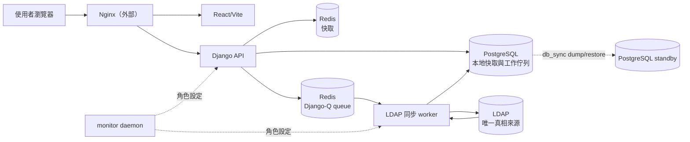
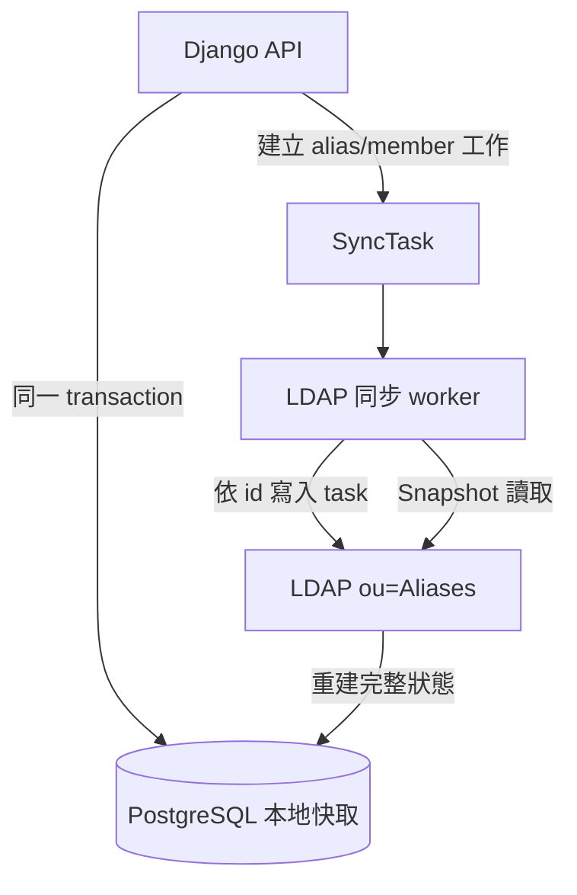
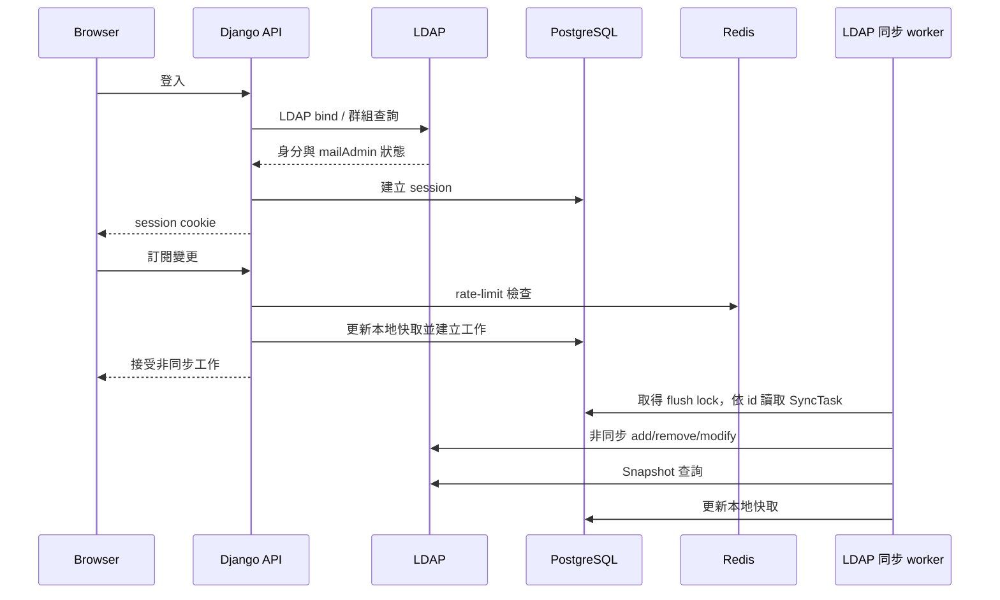

# 01 系統架構

## 系統邊界

系統由 React/Vite 前端、Django REST API、PostgreSQL、Redis、LDAP 同步 worker 與外部 LDAP 組成。Nginx、mail host、Postfix/Mailpit 與 LDAP 服務本身不在本 repository 的 Compose 配置內。

LDAP 是唯一真相來源：登入、使用者群組與 `ou=Aliases` 的 alias 成員狀態以 LDAP 為準。PostgreSQL 是本地快取與工作佇列，供 API 回應、Django session 及待處理變更使用。API 不直接寫入 LDAP；LDAP 寫入只由 ACTIVE 節點的 LDAP 同步 worker 非同步執行。

## 部署拓撲

Compose 的主要服務是 `postgres`、`redis`、`web`、`worker` 與 `frontend`。前端和 API 可由多個節點提供 HTTP；LDAP 寫入則預期只由 ACTIVE 節點的 LDAP 同步 worker 執行。

## 技術棧

| 層 | 技術 | 責任 |
|---|---|---|
| 前端 | React 19、Vite 8、Axios | 使用者與管理員介面 |
| API | Python 3.11、Django、Django REST Framework | session、權限、業務 API |
| 認證 | `django-auth-ldap` | LDAP bind 與 `mailAdmin` 群組映射 |
| 本地資料 | PostgreSQL 15 | 本地快取、Django session 與工作佇列 |
| Queue/cache | Redis 7 | Django-Q queue 與 rate-limit cache |
| 背景工作 | Django-Q2 | LDAP 同步 worker（Flush：依序寫入 task 並以 Snapshot 校正快取） |
| LDAP client | `ldap3` | LDAP 同步 worker 對 LDAP 的讀寫與 TLS 驗證 |

## 資料與責任邊界

主要資料概念如下：

- `Alias` 保存 alias 名稱與顯示資訊。
- `AliasMember` 保存本地成員快取，一列一個 `(alias, uid)`。
- `SyncTask` 是 alias 與成員工作共用的單一 queue；`kind` 區分 `alias`／`member`，`id` 即全域順序。
- LDAP `ou=Aliases` 的 entry 使用 `groupOfUniqueNames` 與 `uniqueMember` 表示實際 alias 成員。

PostgreSQL 本地快取不是 LDAP 的替代品。LDAP 同步 worker 完成佇列工作後再從 LDAP 讀取狀態，將本地快取校正為 LDAP 狀態。alias 與成員工作在同一張 `SyncTask` 表，`id` 決定全域順序。

API 端所有需要同步到 LDAP 的變更都經過同一組寫入函式（`apps/subscriptions/writes.py`）：同一 transaction 內先鎖住該 alias、再更新快取、再排入 task。鎖持有到 commit，所以同一 alias 的 task `id` 順序就是變更生效的順序。細節見 [04 API and DB](./04-api-and-db.md#runtime-behavior)。

Flush 由 sync module（`apps/subscriptions/sync.py`）的 `sync.flush(directory)` 一次執行：依 `id` 把 task 交給 Directory 寫入 LDAP，再以 LDAP snapshot 校正快取；仍有 task 在 queue 中的 alias 不會被 snapshot 覆蓋。合約見 [06 同步介面](./06-sync-interface.md)。

## 主要資料流

因此 API 成功接受訂閱或管理變更，不代表 LDAP 已立即完成寫入；實際完成由 LDAP 同步 worker 的排程與重試狀態決定。

## 業務規則

- alias 名稱只接受英數字與連字號，並作為本地識別鍵。
- 一般使用者只能管理自己的訂閱；`mailAdmin` LDAP 群組映射出的管理員可管理 alias 與成員。
- 所有 alias 與成員變更先寫入 PostgreSQL 本地快取與工作佇列，再由 LDAP 同步 worker 非同步同步 LDAP。
- 每次 Flush 是單一有序流程：alias 與成員 task 共用 `SyncTask`，依 `id` 升冪寫入 LDAP，最後以 Snapshot 校正快取。
- 每個 task 有一個 Outcome：Done（LDAP 已是預期狀態，包含「本來就是」）與 Obsolete（例如 alias 已不在 LDAP）會移出 queue；Retry 保留 task 供下一次 Flush 重試，並在本次 Flush 中擋住同一 alias 的後續 task，其他 alias 照常處理。
- 同一節點同時只有一個 Flush：flush lock 是 PostgreSQL session advisory lock，Flush 結束、出錯或 process 死掉時立即釋放。
- Task budget 為 300 秒：超過後不再交出新 task，進行中的 task 正常完成，其餘留在 queue；Snapshot 仍會執行。
- Snapshot budget 為 60 秒：逾時或任何讀取錯誤都不套用部分結果，快取保持不動。LDAP 本身無法使用時 Flush 立即停止並跳過 Snapshot。
- LDAP bind、TLS 憑證驗證與使用者群組查詢是外部身份服務責任；本地 PostgreSQL 不取代這些查詢。

## 背景任務

Django-Q schedule 每 30 分鐘執行 `flush_ldap_tasks`（`apps/subscriptions/tasks.py`），其流程是：

1. `FLUSH_ENABLED` 不是 `1` 時只記 `flush_disabled` 並結束。
2. 建立 LDAP Directory（`apps/subscriptions/ldap_directory.py`），呼叫 `sync.flush(directory)`，最後一定關閉 Directory。
3. `sync.flush` 取得 PostgreSQL flush lock；已被持有時回傳 busy，worker 記 `flush_lock_busy`，不連 LDAP。
4. 依 `id` 把 Flush 開始時已存在的 task 交給 Directory，受 300 秒 Task budget 限制。
5. 以 Snapshot（60 秒 budget）校正沒有待處理 task 的 alias。
6. worker 記一筆 `flush_summary` JSON event（各 Outcome 數量、停止原因、Snapshot 狀態與實際有變更／略過的 alias、耗時、最舊待處理 task 的秒數；Queue 為空時該欄位為 `null`）；每個 Obsolete task 記一筆 `task_obsolete`。每個 Retry 的 error event 就是 LDAP Directory 在判定時記的 `alias_task_failed`／`user_task_failed`（含 LDAP 錯誤），worker 不另記。非預期例外記 `flush_unexpected_error`（含 traceback）。

Django-Q 的 task kill timeout 為 480 秒，高於 Flush 最壞情況 466 秒：Task budget 300 + 進行中的 task 66（每次 `apply` 開始 16 秒後不再重試，最後一次 attempt 在新連線上最多 connect 10 + TLS handshake 10 + bind 10 + request 10 + 移除最後一位 Member 的 fallback 10）+ Snapshot 100（budget 60，之後最多再一次 40 秒的 attempt）。此上限假設 LDAP URI 只解析到一個位址、每個回應在一個 receive timeout 內收到。re-delivery delay（`retry`）為 540 秒，高於 kill timeout，因此健康的 Flush 不會被中途終止或重複啟動。

flush lock 只防止同一節點重疊 Flush，不是節點 fencing。失敗工作會保留在 queue；告警門檻與詳細處置屬於 [05 Migration](./05-migration.md) 的營運範圍。

## HA 設計與限制

選用的 HA 拓撲由多個 app host、monitor daemon、PostgreSQL dump/restore 同步與角色設定組成。monitor 依 peer 健康狀態、門檻與設定執行**最佳努力仲裁**，並將節點標記為 ACTIVE 或 standby；ACTIVE 節點才預期啟用 LDAP flush。

這不是共識系統，也沒有 quorum、distributed lease、epoch token 或外部 fencing：

- 網路分割時可能出現多個 ACTIVE，不能保證只有一個節點寫 LDAP。
- `FLUSH_ENABLED=0` 是設定 gate，不是 LDAP-side 強制限制；錯誤覆寫或 stale LDAP 同步 worker 仍可能造成寫入。
- PostgreSQL flush lock 只存在於各節點自己的資料庫，不能證明節點仍是 ACTIVE。
- `db_sync.sh` 是 PostgreSQL dump/restore，不是 streaming replication，也不提供一致性快照或災難復原保證。
- 角色變更會重啟 web/worker；切換、同步與 fencing 仍需要外部維運流程。

因此 HA 提供的是依設定與 peer 可達性運作的最佳努力切換，不應被解讀為強一致或嚴格單一寫入者保證。設定與操作步驟請見 [03 建置與啟動](./03-setup.md)，API 與 schema 細節請見 [04 API 與資料庫](./04-api-and-db.md)。
