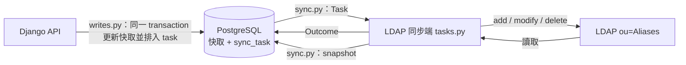

# LDAP 同步介面（sync interface）

本頁是 LDAP 同步端（`apps/subscriptions/tasks.py`）與 task queue／本地快取之間的合約。同步端只需要讀本頁與 `apps/subscriptions/sync.py`，不需要知道 `sync_task`、`alias_member` 等 table 的 schema；schema 之後改動，只要本頁的格式不變，同步端就不用改 code。

## 分工



- **API 端**（`writes.py`，已完成）：每個變更在同一 transaction 內鎖住該 alias、更新快取、排入 task。快取立即反映「LDAP + 尚未寫入的 task」。
- **同步端**（`tasks.py`，你的範圍）：依序把 task 寫進 LDAP、回報結果，最後把 LDAP 的完整狀態交回。
- 同步端**只 import `apps.subscriptions.sync`**，不 import `models`、不直接查詢或修改任何 table。

## 三種格式

### `Task`：一筆待寫入 LDAP 的變更（唯讀）

| 欄位 | 型別 | 說明 |
|---|---|---|
| `id` | `int` | 全域順序；同一 session 內依此遞增給出 |
| `kind` | `str` | `"alias"` 或 `"member"`（常數 `Task.KIND_ALIAS`、`Task.KIND_MEMBER`） |
| `action` | `str` | `"add"` 或 `"remove"`（常數 `Task.ACTION_ADD`、`Task.ACTION_REMOVE`） |
| `alias_name` | `str` | alias 名稱，即 LDAP `cn` |
| `user_uid` | `str \| None` | 只在 `kind == "member"` 時有值，為使用者 uid（不是 DN） |

四種組合對應的 LDAP 意義：

| `kind` / `action` | 意義 |
|---|---|
| `alias` / `add` | 建立 alias entry |
| `alias` / `remove` | 刪除整個 alias entry（成員一起消失；**不會**另外產生每個成員的 remove task） |
| `member` / `add` | 把 `user_uid` 加入該 alias |
| `member` / `remove` | 把 `user_uid` 從該 alias 移除 |

### `Outcome`：task 在 LDAP 的結果

| 值 | 何時用 | 對 queue 的效果 |
|---|---|---|
| `Outcome.DONE`（`"done"`） | LDAP 已是 task 要的狀態，包含「本來就是」：entry already exists、value already exists、no such attribute | 移出 queue |
| `Outcome.RETRY`（`"retry"`） | 暫時性失敗，例如連線中斷、retry 用盡 | 保留在原位置；本 session 不再給出**該 alias** 的後續 task，下次 flush 從它開始 |
| `Outcome.OBSOLETE`（`"obsolete"`） | task 已無意義，例如 member task 的 alias entry 在 LDAP 不存在（`noSuchObject`） | 移出 queue，只是 log 上和 `DONE` 區分 |

接受 enum 或對應字串；其他值會丟 `ValueError`。

### Snapshot：LDAP 的完整狀態

```python
{alias_name: set_of_uids}   # 例：{"nasa": {"alice", "bob"}, "empty": set()}
```

- 必須包含 LDAP `ou=Aliases` 下的**每一個** alias；不在 snapshot 的 alias 會從快取刪除。
- 值是 uid，不是 DN；不包含 placeholder 成員（目前是 `LDAP_BIND_DN`）。
- 沒有成員的 alias 用空集合，不要省略。

## 呼叫流程

```python
from apps.subscriptions import sync

with sync.flush_session() as session:
    while (task := session.next_task()) is not None:
        outcome = apply_to_ldap(conn, task)      # 你的實作，回傳 Outcome
        session.report(task, outcome)
    session.apply_snapshot(read_ldap_snapshot(conn))  # 你的實作
```

| 呼叫 | 說明 |
|---|---|
| `sync.flush_session()` | context manager，開啟一次 flush。離開時尚未回報的 task 視為 `RETRY` |
| `session.next_task()` | 回傳下一筆 `Task`；沒有了回傳 `None` |
| `session.report(task, outcome)` | 回報**最近一次** `next_task()` 給出的 task。回報其他 task 或重複回報丟 `sync.SessionError` |
| `session.apply_snapshot(snapshot)` | 用 snapshot 校正快取，回傳 `SnapshotResult(updated, skipped)`：兩個 alias 名稱 list |

session 關閉後再呼叫任何方法都丟 `sync.SessionError`。

## 你可以依賴的保證

- **順序**：task 依 `id` 給出；同一 alias 的 task 順序就是 API 變更 commit 的順序。alias 與 member task 共用同一個順序，所以「刪除 alias A → 建立 A → 加入 y」會依序給出，`加入 y` 不會被前面的刪除吃掉。
- **一次一筆**：`next_task()` 每次取目前 queue 中最小的 `id`，所以較晚 commit、但 `id` 較小的 task 也不會被跳過。
- **失敗隔離**：某 alias 回報 `RETRY` 後，本 session 不再給出該 alias 的 task；其他 alias 照常進行。
- **一定會結束**：session 只給出開啟時已存在的 task；session 期間 API 新增的 task 留給下一次 flush。
- **不覆蓋未寫入的變更**：`apply_snapshot` 對仍有 task 在 queue 中的 alias（尚未處理或 `RETRY`）不做任何事，該 alias 的快取保留 API 寫入的結果，等 task 清空後的 flush 再校正。每個 alias 的檢查與寫入都在 API 使用的同一把 per-alias lock 內，API 寫入無法插在中間。
- 快取的 `display_name`、`description` 等顯示欄位不受 snapshot 影響。

## 仍由同步端負責

- **`FLUSH_ENABLED` 檢查與 Redis flush lock**（目前 `FLUSH_LOCK_KEY`，TTL 300 秒）：避免同時有兩個 session。介面本身不防止並行 session。
- **把 `Task` 轉成 LDAP 操作**：DN 組法、`groupOfUniqueNames` 至少需要一個 `uniqueMember`（目前建立時用 `LDAP_BIND_DN` 當 placeholder）、LDAP 回應碼對應到哪個 `Outcome`、retry 次數與間隔。
- **讀取 LDAP 組成 snapshot**：DN 轉 uid、去掉 placeholder。
- **LDAP 讀取失敗或結果不完整（例如 size limit）時不要呼叫 `apply_snapshot`**：不完整的 snapshot 會讓缺少的 alias 從快取被刪除。直接結束 session 即可，下次 flush 再校正。
- **log 與告警**：介面不記 log。

## 與舊實作的差異（port 時注意）

- 舊的 `flush_alias_tasks` 在 alias remove 後會刪掉該 alias 的所有 user task。**新版不可這樣做**：介面已保證順序，那些 task 可能屬於之後重新建立的同名 alias。alias 不存在時，member task 回報 `OBSOLETE` 即可。
- 舊流程先處理全部 alias task、再處理全部 user task；新版只有一條依 `id` 的序列。
- 舊的 `run_consistency_check` 直接寫 `Alias.user_id`；新版改為組 snapshot 交給 `apply_snapshot`，不直接寫快取。
- 舊流程一筆失敗不會停下同 alias 的後續 task；新版回報 `RETRY` 後該 alias 本次停下，下次 flush 從失敗的那筆重試。

## 測試

- 使用 Django test DB 搭配真實的 `sync` 介面，mock `ldap3`；本 repository 沒有 LDAP fixture，也沒有不需 DB 的假實作。
- 介面用法範例見 `apps/subscriptions/tests/test_sync.py`；建立測試資料可用 `apps/subscriptions/writes.py` 的函式（例如 `writes.create_alias`、`writes.add_member`），與 API 實際產生 task 的方式相同。
- `apps/subscriptions/tests/test_tasks.py` 是舊同步端的測試，目前因 import 已移除的 model 而無法載入，需隨 `tasks.py` 一起改寫。

## 完成條件

- `tasks.py` 只透過 `apps.subscriptions.sync` 存取 queue 與快取，不再 import `AliasTaskQueue`、`UserTaskQueue`、`Alias` 等 model。
- `docker compose exec web python manage.py test` 中 `test_tasks.py` 可載入並通過。
- 移除 [01 架構](./01-architecture.md)、[04 API 與資料庫](./04-api-and-db.md) 與 [05 Migration](./05-migration.md) 中的「過渡狀態」說明，並把 01 的「業務規則」「背景任務」改為新流程。

已知與本介面無關的既有測試失敗：`test_api.py` 的 `AdminAliasUserAddApiTest`（5 個測試未 mock LDAP 使用者查詢）與成員刪除 invalid UID 測試（期待 `400`，實際 `404`，見 04 的 Known implementation differences）。
