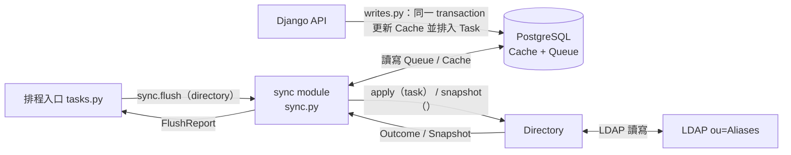

# LDAP 同步介面（sync interface）

本頁是 sync module（`apps/subscriptions/sync.py`）與 Directory 之間的合約。sync module 擁有 Queue（`sync_task`）與 Cache（`alias`、`alias_member`），對外只有一個呼叫：`sync.flush(directory)`，執行一次完整的 Flush 並回傳 flush report。Directory（production 為 LDAP Directory）只需要讀本頁，不需要知道任何 table 的 schema，也不 import `models`。

## 分工



- **API 端**（`writes.py`）：每個變更在同一 transaction 內鎖住該 Alias、更新 Cache、排入 Task。Cache 立即反映「LDAP + 尚未寫入的 Task」。
- **sync module**（`sync.py`）：flush lock、Task 順序、per-Alias blocking、Task budget、Snapshot 校正，全部在這裡。不記 log。
- **Directory**：把一筆 Task 寫進 LDAP 並回傳 Outcome；讀出完整 Snapshot。只有它知道 LDAP 的 DN、result code 與 Placeholder member。
- **排程入口**（`tasks.py`）：檢查 `FLUSH_ENABLED`、建立 Directory、呼叫 `sync.flush`、把 flush report 記成 log。

## 公開名稱

都從 `apps.subscriptions.sync` import：

| 名稱 | 說明 |
|---|---|
| `flush(directory, *, task_budget=300, clock=time.monotonic)` | 執行一次 Flush，回傳 `FlushReport`。`task_budget`（秒）與 `clock` 只給測試用 |
| `Directory` | protocol：`apply(task) -> Outcome`、`snapshot() -> Snapshot` |
| `DirectoryUnavailable` | Directory 本身無法使用時（LDAP 連不上、過載）由 `apply` 或 `snapshot` 丟出 |
| `Task` | 一筆待寫入的變更（唯讀） |
| `Outcome` | Task 的結果：`DONE`、`RETRY`、`OBSOLETE` |
| `Snapshot` | type alias：`Mapping[str, Set[str]]` |
| `FlushReport`、`StopReason`、`SnapshotStatus` | flush report 與其欄位的 enum |

## Directory protocol

```python
class Directory(Protocol):
    def apply(self, task: Task) -> Outcome: ...
    def snapshot(self) -> Snapshot: ...
```

- `apply` 寫入一筆 Task 並回傳 `Outcome`（也接受對應字串；其他值丟 `ValueError`，視為非預期錯誤）。
- `snapshot` 回傳**完整**的 Snapshot；讀不完整（size limit、逾時、搜尋錯誤）時必須丟 `DirectoryUnavailable`，不可回傳部分結果。
- 兩者都可以丟 `DirectoryUnavailable` 表示 Directory 本身無法使用。其他例外視為 bug，見[保證](#保證)。

### `Task`

| 欄位 | 型別 | 說明 |
|---|---|---|
| `id` | `int` | Queue 中的全域順序 |
| `kind` | `str` | `"alias"` 或 `"member"`（常數 `Task.KIND_ALIAS`、`Task.KIND_MEMBER`） |
| `action` | `str` | `"add"` 或 `"remove"`（常數 `Task.ACTION_ADD`、`Task.ACTION_REMOVE`） |
| `alias_name` | `str` | Alias 名稱，即 LDAP `cn` |
| `user_uid` | `str \| None` | 只在 `kind == "member"` 時有值，為 Member 的 uid（不是 DN） |

| `kind` / `action` | 意義 |
|---|---|
| `alias` / `add` | 建立 Alias entry |
| `alias` / `remove` | 刪除整個 Alias entry（Member 一起消失；**不會**另外產生每個 Member 的 remove Task） |
| `member` / `add` | 把 `user_uid` 加入該 Alias |
| `member` / `remove` | 把 `user_uid` 從該 Alias 移除 |

### `Outcome`

| 值 | 何時用 | 對 Queue 的效果 |
|---|---|---|
| `Outcome.DONE`（`"done"`） | Directory 已是 Task 要的狀態，包含「本來就是」 | 移出 Queue |
| `Outcome.RETRY`（`"retry"`） | 失敗，下次 Flush 再試 | 保留在原位置；本次 Flush 不再給出**該 Alias** 的後續 Task |
| `Outcome.OBSOLETE`（`"obsolete"`） | Task 已無意義，例如 Member Task 的 Alias 已不在 LDAP | 移出 Queue，在 report 中與 `DONE` 區分 |

### Snapshot

```python
{alias_name: set_of_uids}   # 例：{"nasa": {"alice", "bob"}, "empty": set()}
```

- 包含 LDAP `ou=Aliases` 下的**每一個** Alias；不在 Snapshot 中的 Alias 會從 Cache 刪除。
- 值是 uid，不是 DN；不含 Placeholder member。
- 沒有 Member 的 Alias 對應空集合，不可省略。

## Flush 流程

1. **flush lock**：以 PostgreSQL session advisory lock（`pg_try_advisory_lock(FLUSH_LOCK_NAMESPACE, FLUSH_LOCK_KEY)`，namespace 與 per-Alias write lock 不同）取得。已被其他連線持有時，直接回傳 `busy=True` 的 report，不呼叫 Directory。
2. **Task 範圍**：記下開始時最大的 Task `id`，只給出不超過它的 Task。
3. **逐筆給出**：每次取剩餘 Task 中最小的 `id`（排除本次已 blocked 的 Alias），呼叫 `directory.apply(task)`。
4. 給出每筆 Task 前檢查 **Task budget**（預設 300 秒）；用完就停止給出，其餘 Task 原封不動留在 Queue。
5. **Snapshot**：除非 `apply` 丟過 `DirectoryUnavailable`，否則呼叫 `directory.snapshot()`（budget 用完也照常進行），逐一校正每個出現在 Snapshot 或 Cache 中的 Alias。
6. 釋放 flush lock，回傳 `FlushReport`。

## Flush report（`FlushReport`）

| 欄位 | 型別 | 說明 |
|---|---|---|
| `busy` | `bool` | flush lock 被其他連線持有，本次什麼都沒做 |
| `done_count` | `int` | `DONE` 的 Task 數 |
| `retried` / `retry_count` | `list[Task]` / `int` | `RETRY` 的 Task（Alias、kind、action、uid）與數量 |
| `obsoleted` / `obsolete_count` | `list[Task]` / `int` | `OBSOLETE` 的 Task 與數量 |
| `stop_reason` | `StopReason` | `NONE`（`"none"`）、`BUDGET`（`"budget"`）、`DIRECTORY_UNAVAILABLE`（`"directory_unavailable"`） |
| `snapshot_status` | `SnapshotStatus` | `APPLIED`（`"applied"`）、`FAILED`（`"failed"`，`snapshot()` 丟 `DirectoryUnavailable`）、`NOT_TAKEN`（`"not_taken"`，busy 或 `apply` 時 Directory 無法使用） |
| `snapshot_updated` | `list[str]` | Snapshot 校正過的 Alias 名稱（依名稱排序） |
| `snapshot_skipped` | `list[str]` | 因仍有 Task 在 Queue 而略過的 Alias 名稱 |
| `elapsed` | `float` | Flush 花費秒數（busy 時為 `0.0`） |
| `oldest_task_age` | `float \| None` | Flush 結束時 Queue 中最舊 Task 已等待的秒數（依 `sync_task.created_at`）；Queue 為空時為 `None` |

## 保證

- **同時只有一個 Flush**：flush lock 是 session-level，Flush 結束（正常回傳或丟例外）就釋放；process 死掉時連線關閉也會釋放。
- **順序**：Task 依 `id` 給出；同一 Alias 的 Task 順序就是 API 變更 commit 的順序。Alias 與 Member Task 共用同一個順序，所以「刪除 Alias A → 建立 A → 加入 y」會依序給出。較晚 commit、但 `id` 較小的 Task 也不會被跳過。
- **失敗隔離**：某 Alias 的 Task 回 `RETRY` 後，本次 Flush 不再給出該 Alias 的 Task；其他 Alias 照常進行。下次 Flush 從失敗的那筆重試。
- **一定會結束**：Flush 期間 API 新增的 Task 留給下一次 Flush。
- **Task budget**：budget 在給出 Task 前檢查，進行中的 Task 一定會做完，不會半途中斷。
- **Directory 無法使用**：`apply` 丟 `DirectoryUnavailable` 時，該 Task 留在 Queue，不再給出 Task，也不讀 Snapshot。
- **不校正尚未寫入的變更**：Snapshot 對仍有 Task 在 Queue 中的 Alias 不做任何事。每個 Alias 的檢查與寫入都在 API 使用的同一把 per-Alias lock 內，各自一個短 transaction，API 寫入無法插在中間。
- **部分 Snapshot 不會破壞 Cache**：`snapshot()` 丟 `DirectoryUnavailable` 時 Cache 完全不動。
- Cache 的 `display_name`、`description` 等顯示欄位不受 Snapshot 影響。
- **非預期錯誤**：`DirectoryUnavailable` 以外的例外會在釋放 flush lock 後往外丟；進行中的 Task 不會被刪除。
- 整個 Flush 使用 Django 的 default 資料庫連線，中途不關閉或更換（flush lock 必須在同一連線上取得與釋放）。
- sync module 不記 log；需要的資訊都在 flush report 中。

## 排程入口與 log event

`apps/subscriptions/tasks.py` 的 `flush_ldap_tasks`（Django-Q 每 30 分鐘執行）：

1. `FLUSH_ENABLED` 不是 `1`：記 `flush_disabled`，不建立 Directory。
2. 否則建立 `LdapDirectory()`、呼叫 `sync.flush(directory)`，最後一定呼叫 `directory.close()`。
3. 依 flush report 記 log（JSON，logger `mailsub-worker`，見 `apps/subscriptions/log.py`）：

| event | level | 何時 | 欄位 |
|---|---|---|---|
| `flush_lock_busy` | INFO | report 為 busy | - |
| `task_obsolete` | INFO | 每個 `OBSOLETE` Task 一筆 | `task_id`、`kind`、`action`、`alias_name`、`user_uid` |
| `flush_summary` | INFO | 每次非 busy 的 Flush 一筆 | `done_count`、`retry_count`、`obsolete_count`、`stop_reason`、`snapshot_status`、`snapshot_updated`、`snapshot_skipped`、`elapsed_seconds`、`oldest_task_age_seconds`（Queue 為空時省略） |
| `flush_unexpected_error` | ERROR | 建立 Directory、Flush 或記 log 時發生非預期例外（例如未設定 `LDAP_CA_CERT_FILE`） | `error` |

每個 `RETRY` Task 由 LDAP Directory 在判定時記一筆 `alias_task_failed`／`user_task_failed`（ERROR，含 `task_id`、`alias_name`、`user_uid` 與 LDAP `error`）；排程入口不重複記錄。LDAP 細節 event（`ldap_retry`、`ldap_connect_failed`、`ldap_unavailable`、`member_dn_skipped` 等）也由 LDAP Directory 記錄。

## 測試

- `apps/subscriptions/tests/fakes.py` 的 `FakeDirectory` 是共用的 in-memory Directory：記錄 `apply` 過的 Task（`applied`）、依 Task `id` 或 Alias 名稱回傳指定的 Outcome 或丟出指定例外、回傳指定的 Snapshot 或丟出例外（`snapshot_calls` 記錄呼叫次數）、記錄 `close()` 次數（`close_calls`），並可用 `on_apply` 在 Flush 中途插入動作（例如新增 Task 或推進假時鐘）。
- 測試使用 Django test DB，以 `apps/subscriptions/writes.py` 的函式（例如 `writes.create_alias`、`writes.add_member`）建立資料，與 API 產生 Task 的方式相同。不 mock、不連 LDAP。範例見 `apps/subscriptions/tests/test_sync.py`；排程入口的測試（`test_tasks.py`）以 `FakeDirectory` 取代 `LdapDirectory` constructor。
